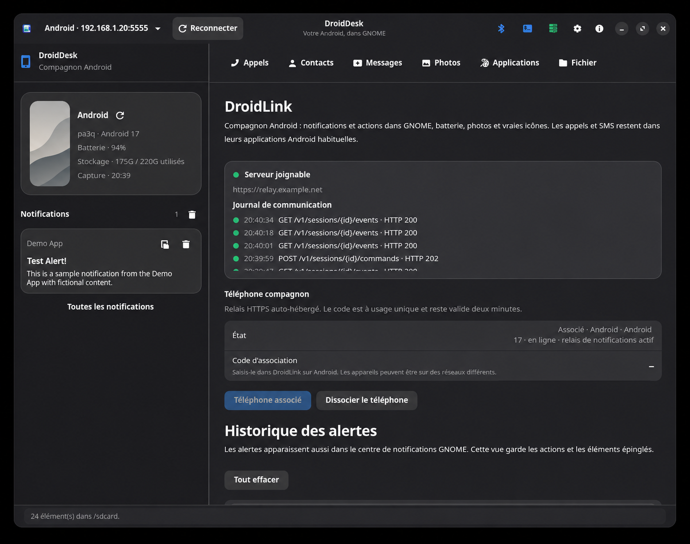
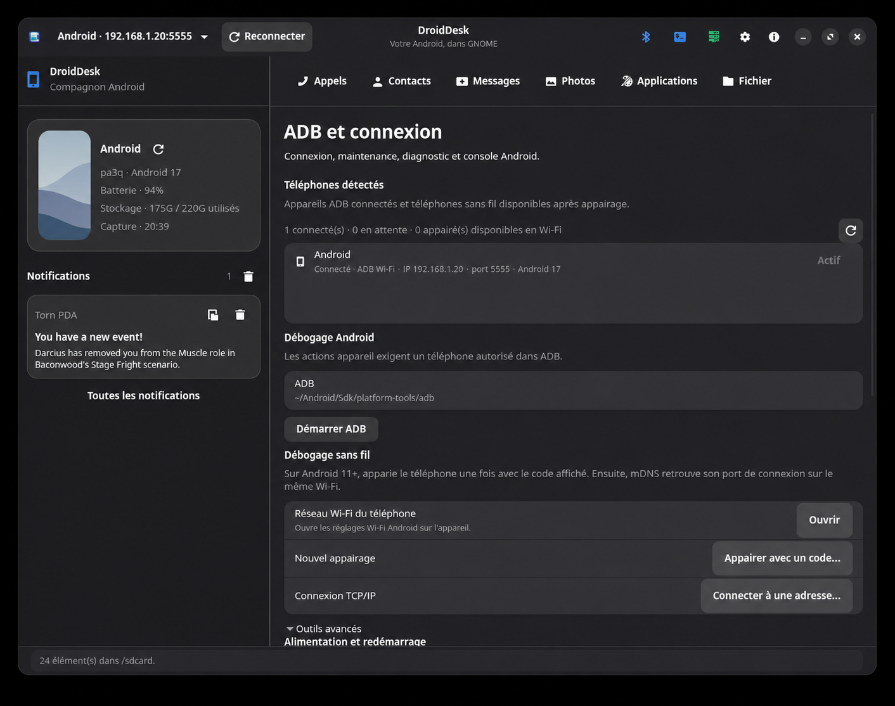
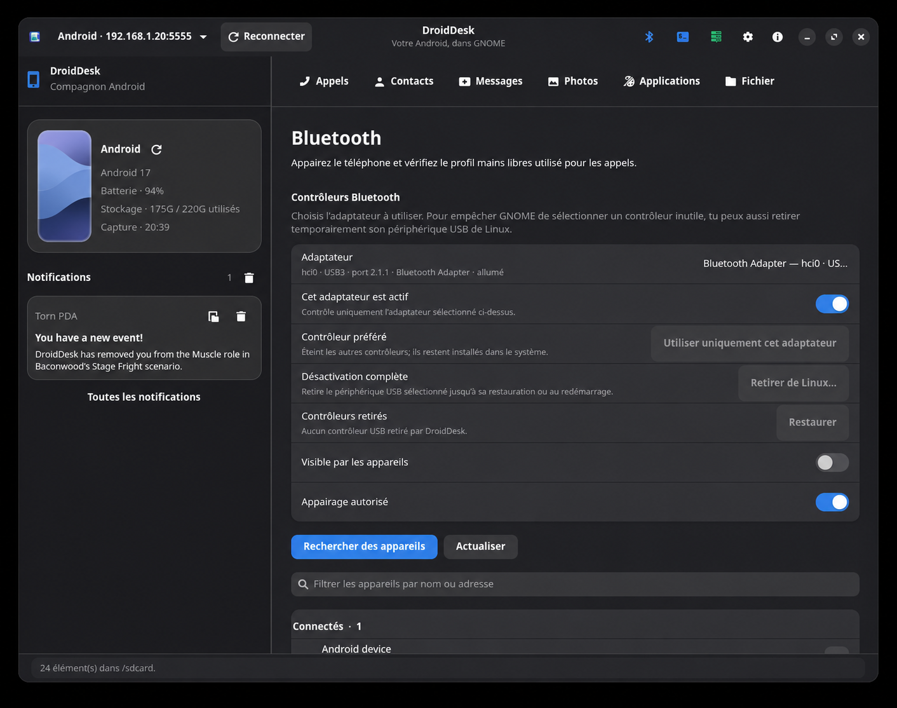
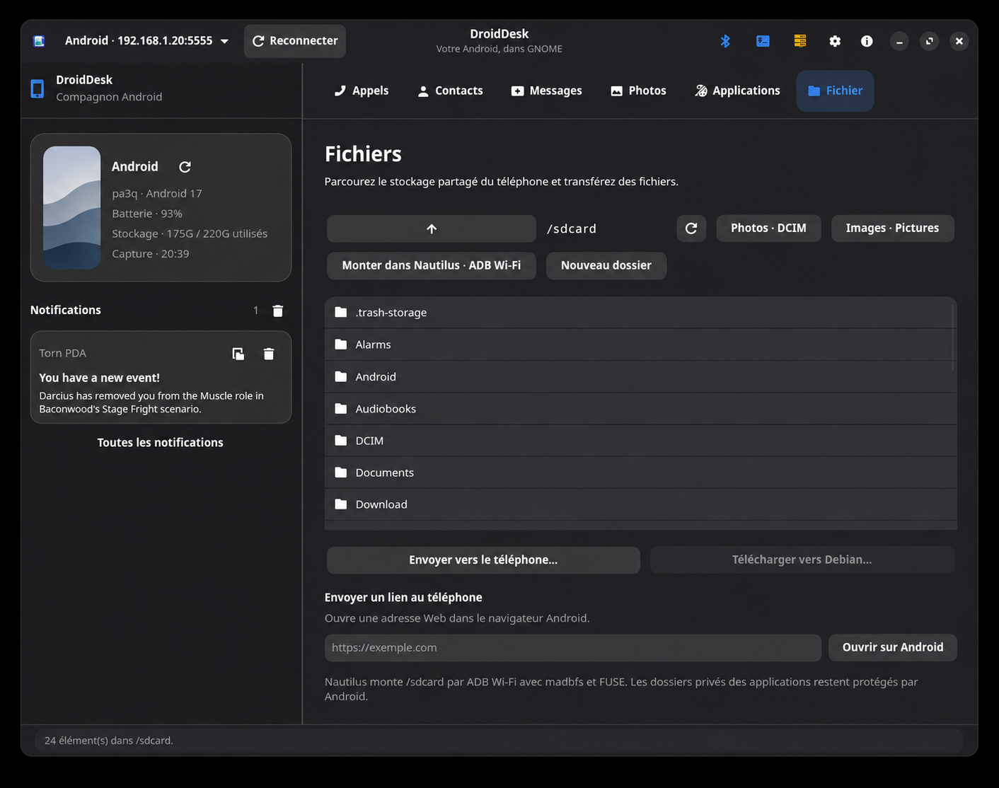
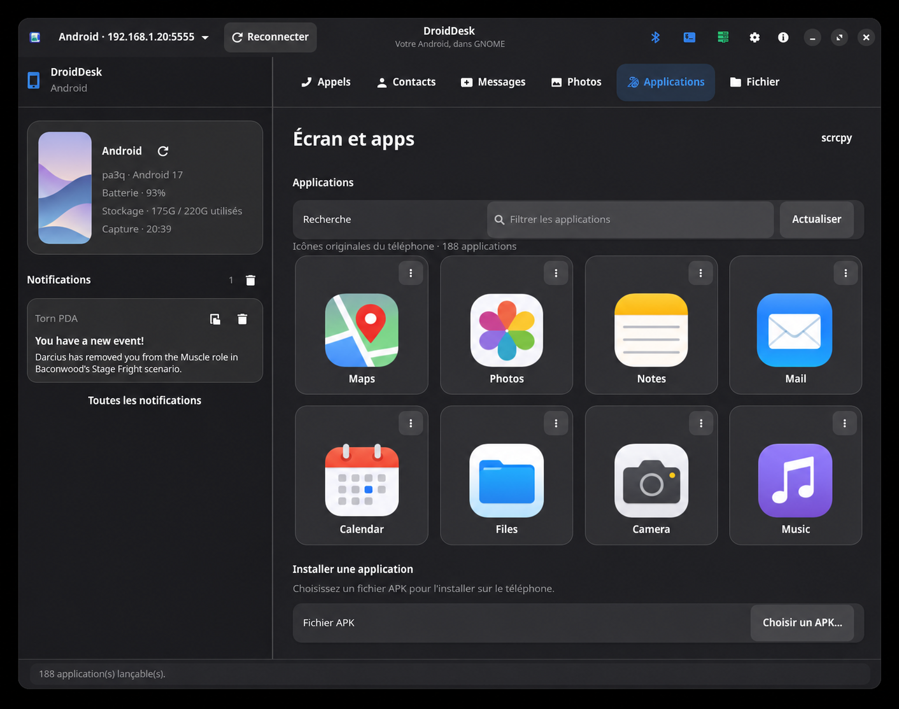
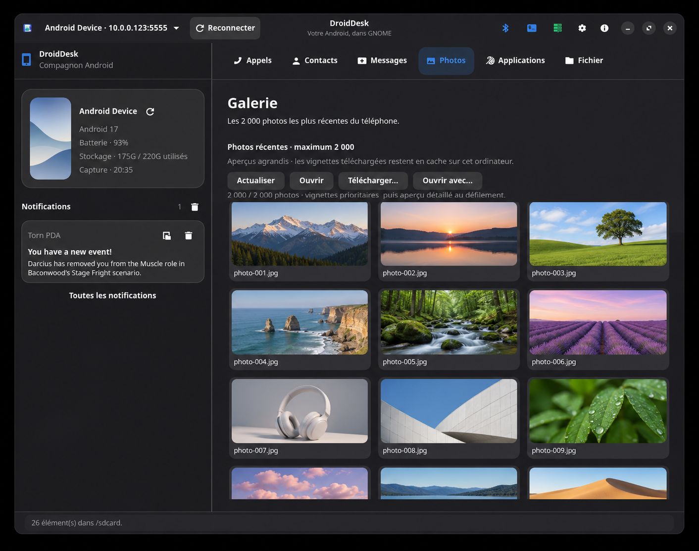
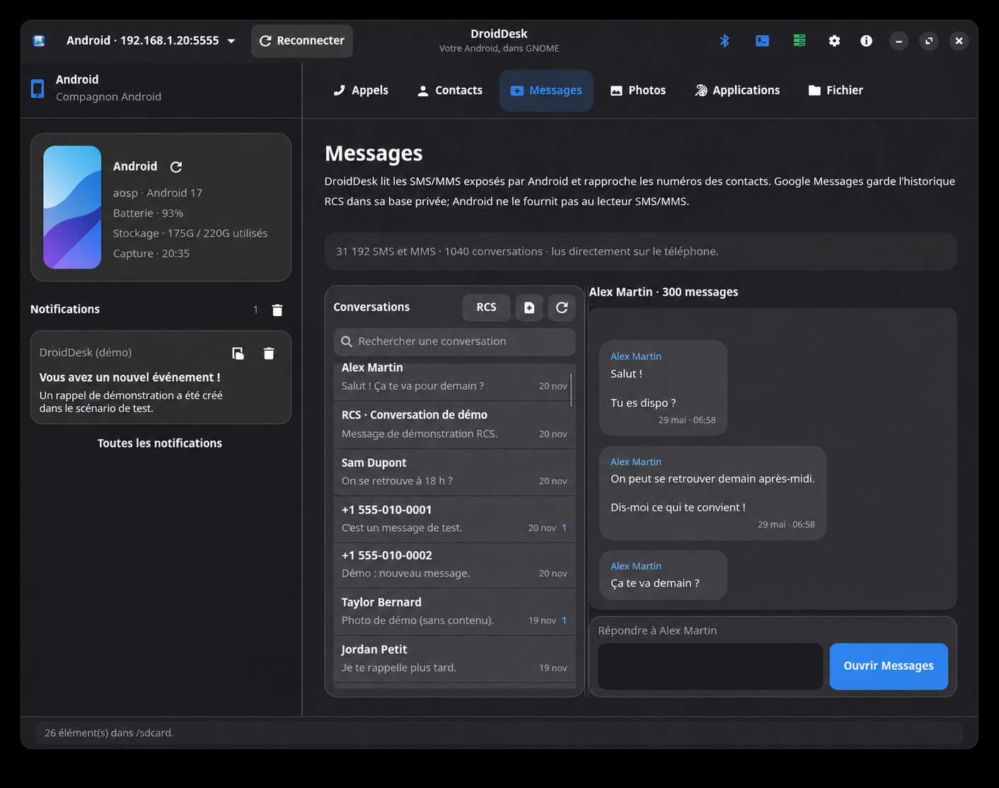
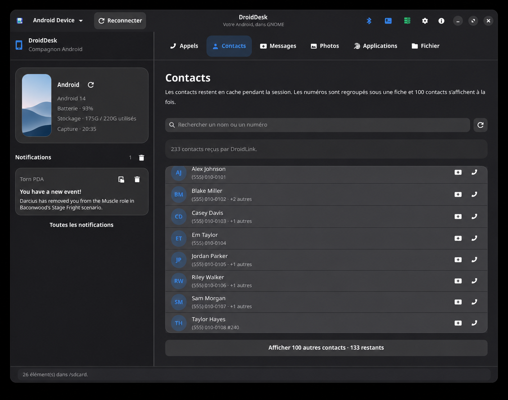
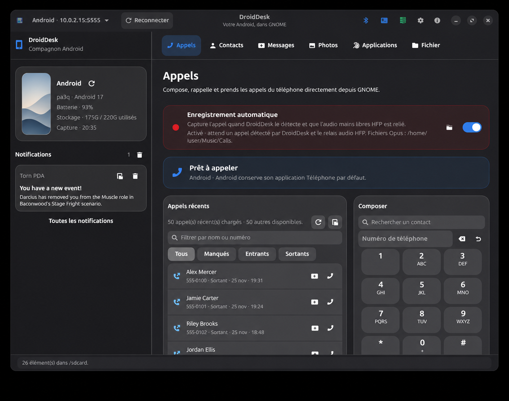

# DroidDesk

DroidDesk est une application GTK4/libadwaita pour gérer un téléphone Android depuis GNOME avec ADB, scrcpy et BlueZ.

## DroidDesk 0.2.0

La version 0.2.0 réunit le compagnon Android DroidLink, un relais auto-hébergé configurable et plusieurs améliorations de contrôle, de fichiers et d’applications. Consulte les [notes de version](release/0.2.0.md) et les [releases GitHub](https://github.com/simonpatap0n/DroidDesk/releases).

### Captures d’écran

Les captures ci-dessous sont des exemples anonymisés, préparés pour illustrer l’application sans exposer les données du téléphone.

| DroidLink | ADB et connexion | Bluetooth |
| --- | --- | --- |
|  |  |  |

| Fichiers | Applications | Galerie |
| --- | --- | --- |
|  |  |  |

| Messages | Contacts | Appels |
| --- | --- | --- |
|  |  |  |

## Fonctionnalités

- **Appels dans GNOME** : lancer un appel avec l’application Téléphone Android habituelle, répondre/refuser/raccrocher avec les commandes ADB. Le téléphone garde sa SIM; Bluetooth HFP/HSP transporte la voix entre Android et le PC. L’enregistrement automatique optionnel capture la conversation en Opus quand DroidDesk détecte l’appel et relie HFP; les fichiers vont dans `Musique/DroidDesk Calls`.
- **Contacts** : lecture par DroidLink avec l’autorisation Android Contacts; ADB reste un mode de repli pendant la migration. **Récents** : journal d’appels encore lu via ADB.
- **SMS** : lire les conversations et l’historique existants depuis la base SMS Android via ADB; préparer une réponse dans l’application Messages du téléphone.
- **Écran et apps** : afficher et contrôler scrcpy dans DroidDesk ou ouvrir une fenêtre native scrcpy; parcourir les applications avec leurs vraies icônes Android, afficher leurs réglages ou les désinstaller avec le clic droit.
- **Fichiers et photos** : parcourir `/sdcard` par ADB, envoyer et télécharger des fichiers; monter le stockage par MTP en USB ou madbfs/FUSE par ADB Wi-Fi; afficher les 2 000 photos récentes avec vignettes puis aperçus haute résolution, et supprimer une photo après confirmation Android.
- **Webcam du téléphone** : DroidLink transmet la caméra autorisée comme périphérique vidéo `DroidDesk Camera`, sélectionnable dans OBS, Meet et les autres applications GNOME.
- **Bluetooth** : choisir un contrôleur (USB ou intégré), activer la radio, rechercher, appairer, connecter, renommer et oublier des appareils.
- **ADB** : appairage sans fil, connexions TCP/IP, redémarrage/récupération/bootloader, touches système, captures d’écran, logcat, propriétés Android et console `adb shell`.
- **Infos téléphone** : le fabricant, le modèle, Android, la batterie et le stockage partagé restent visibles dans l’en-tête, avec un bouton d’actualisation.
- **Notifications** : les alertes Android arrivent comme notifications natives GNOME. Les fermer dans GNOME les ignorera aussi sur le téléphone; DroidDesk garde les 50 dernières alertes et permet d’effacer toute la liste.
- **DroidLink** : lien Android pour les notifications, la batterie, les photos, les icônes d’applications et les demandes de suppression confirmées sur le téléphone. Le domaine HTTPS de ton propre relais se configure dans les deux applications. DroidLink ne remplace pas l’application Téléphone.
- **Icône** : icône SVG originale, installée dans GNOME et conservée dans [`data/io.github.example.DroidDesk.svg`](data/io.github.example.DroidDesk.svg).
- **Fonctions inspirées de KDE Connect** : batterie Android dans l’en-tête, sonnerie à distance, notifications et réponses rapides, partage de fichiers et de liens, ouverture MTP dans GNOME Files.

## Dépendances Debian

```sh
sudo apt update
sudo apt install bluez adb scrcpy ffmpeg v4l2loopback-dkms v4l2loopback-utils gvfs-backends python3 python3-gi gir1.2-gtk-4.0 gir1.2-adw-1 meson ninja-build
```

Le montage Nautilus sans fil nécessite également **madbfs** et **FUSE**. Leur nom de paquet dépend de la version de Debian; installe-les depuis les dépôts de ta distribution avant de choisir **Monter dans Nautilus · ADB Wi-Fi**.

BlueZ doit être actif pour gérer le Bluetooth. Au besoin :

```sh
sudo systemctl enable --now bluetooth
```

## Connexion du téléphone

### USB

1. Sur Android, active **Options pour les développeurs → Débogage USB**.
2. Branche le téléphone et accepte l’empreinte d’ordinateur affichée.
3. Dans DroidDesk, choisis le téléphone dans le sélecteur en haut.

### ADB sans fil

Sur Android 11 ou plus récent, active **Options pour les développeurs → Débogage sans fil** et connecte le téléphone au même Wi-Fi que l’ordinateur. Dans la page **ADB** de DroidDesk, appaire-le une seule fois avec **Appairer avec un code…**; l’adresse et le port de l’écran « Associer un appareil » ne servent qu’à cet appairage. Ensuite, DroidDesk découvre le port de connexion changeant avec mDNS : clique **Connecter** dans la liste des appareils appairés, ou **Reconnecter** en haut pour lancer la reconnexion automatiquement. Android 17 et ADB Wi‑Fi 2.0 demandent Android SDK Platform Tools 37 ou plus récent; vérifie aussi que `adb server-status` indique `mdns_enabled: true`. mDNS ne traverse pas le réseau mobile ni les réseaux Wi-Fi isolés.

## Lancer depuis les sources

Depuis la racine du dépôt :

```sh
python3 src/droiddesk.py
```

## Installer dans GNOME

Depuis la racine du dépôt :

```sh
meson setup build --prefix="$HOME/.local"
meson install -C build
```

DroidDesk apparaît alors dans le lanceur GNOME. Pour le lancer depuis un terminal :

```sh
droiddesk
```

## Compagnon Android DroidLink

Le projet Android est dans [`droidlink/`](droidlink/README.md). Il fournit une interface Material 3, l’association par code à usage unique, le relais HTTPS de notifications, photos, icônes et commandes. L'appairage DroidLink ne demande ni débogage USB ni options développeur. Les fonctions Android du bureau qui ne sont pas encore migrées vers le compagnon continuent de demander ADB.

Le relais auto-hébergé et son déploiement Docker avec Nginx Proxy Manager sont documentés dans [`droidlink/relay/README.md`](droidlink/relay/README.md). Choisis un nom de domaine et configure la même adresse HTTPS dans DroidDesk et DroidLink avant l’association; le port privé du conteneur doit être accessible uniquement depuis NPM.

Pour préparer l’APK, installe Java 17 ou plus récent, **Android SDK Platform 37** et **Android SDK Build-Tools 36.0.0** dans Android Studio (**Settings → Android SDK**), puis lance :

```sh
cd droidlink
./build-apk.sh
```

Le Wrapper fourni télécharge Gradle 9.6.0 et les dépendances Gradle au premier build; Internet est requis à cette étape. `ANDROID_SDK_ROOT` peut indiquer l’emplacement du SDK si le script ne le détecte pas automatiquement. L’APK se trouve dans `droidlink/app/build/outputs/apk/debug/app-debug.apk`; transfère-le sur Android et ouvre-le pour l’installer. ADB reste une option d’installation pour le développement, pas une exigence d’installation ou d’utilisation de DroidLink.

## Appels, écran et SMS

Dans **Appels**, DroidDesk lance l’action Android `ACTION_CALL` avec le numéro composé; Android ouvre le service d’appel associé à l’application Téléphone standard. Les boutons Répondre, Refuser et Terminer envoient les touches casque via ADB. DroidLink n’est pas le composeur et ne demande pas le rôle Téléphone. Android documente `ACTION_CALL` comme l’action qui lance l’appel directement; l’action `ACTION_DIAL` affiche le composeur et demande une confirmation sur le téléphone ([documentation Android](https://developer.android.com/guide/components/intents-common#Phone)).

ADB transmet les commandes, pas le son. Pour parler et écouter avec le PC, le téléphone doit être connecté à Debian en Bluetooth mains libres HFP/HSP; A2DP ne transporte pas le microphone. Utilise **Configurer le Bluetooth mains libres** dans Appels puis connecte le profil HFP de l’appareil Android.

Après installation de l’APK, ouvre les Réglages rapides Android, touche **Modifier** et ajoute la tuile **DroidLink**. Elle ouvre le compagnon de connexion; Android laisse l’utilisateur choisir la position de cette tuile.

Dans **Écran et apps**, choisir une application l’ouvre sur Android et l’affiche dans la zone intégrée de DroidDesk. **Pop-up scrcpy** ouvre en plus la fenêtre native scrcpy avec le serial ADB actif, y compris l’adresse et le port en Wi‑Fi, et le même binaire ADB que DroidDesk.

Dans **Fichiers**, **Monter dans Nautilus · ADB Wi-Fi** monte `/sdcard` dans GNOME Files via madbfs et FUSE. La connexion ADB Wi-Fi doit déjà être active. Le montage reste en lecture/écriture selon les droits Android; les dossiers privés des applications demeurent protégés.

Dans **Écran et apps**, la molette envoie le défilement à l’application Android affichée. **Pop-up scrcpy** lance la fenêtre native scrcpy pour le téléphone actuellement connecté.

Pour utiliser le téléphone comme webcam, associe DroidLink, ouvre **Partage** sur Android et démarre le partage de caméra. Dans **Fichiers** sur le PC, clique **Activer la webcam du téléphone**; DroidDesk charge `v4l2loopback` après autorisation système et expose `/dev/video42` sous le nom **DroidDesk Camera**. Choisis cette caméra dans l’application vidéo. Arrête le flux depuis DroidLink ou le bouton DroidDesk. Le flux JPEG transite par le relais HTTPS auto-hébergé; son administrateur peut voir la vidéo en transit. La fonction demande uniquement la permission Android **Caméra**, aucun micro ni accès audio d’appel.

La page **SMS** lit les messages enregistrés dans `content://sms` via la commande ADB `content query`; les messages et numéros ne sont pas transmis au service DroidLink. DroidDesk conserve localement une copie privée des conversations et des derniers fils consultés pour les réafficher immédiatement au prochain démarrage; les fichiers sont limités à l’utilisateur du compte Linux et restent dans le cache `~/.cache/droiddesk/messages/`. Le bouton de réponse ouvre Messages Android avec le destinataire et le texte préremplis afin que l’application habituelle confirme l’envoi. Android protège les permissions SMS des applications tierces; la lecture directe ici utilise le fournisseur accessible à l’utilisateur `shell` d’ADB.

La galerie garde aussi la liste des photos et les images déjà reçues dans `~/.cache/droiddesk/gallery/`. Elle affiche d’abord les petites vignettes des 2 000 photos les plus récentes, puis télécharge des aperçus plus détaillés pour les éléments visibles; ouvrir ou télécharger une photo transfère son fichier original à la demande. Ces caches locaux sont réservés à l’utilisateur Linux.

## Cible Phone Link

La liste suivante sert de critères de livraison; les fonctions marquées « à intégrer » ne sont pas encore disponibles dans cette version.

| Domaine | Disponible maintenant | À intégrer dans DroidLink |
| --- | --- | --- |
| SMS | Historique des SMS et conversations via ADB; réponse préremplie dans Messages Android | Envoi depuis le PC sans confirmation sur le téléphone, médias SMS/MMS et GIF |
| Appels | Lancement et commandes au moyen du Téléphone Android standard; notifications d’appel dans GNOME; audio par Bluetooth HFP/HSP | État d’appel en temps réel selon le téléphone et le profil Bluetooth |
| Photos | Galerie des 2 000 plus récentes, vignettes à la demande, aperçu, téléchargement et ouverture externe | Glisser-déposer directement depuis la galerie; l’aperçu permet déjà de glisser le fichier local |
| Intégration du téléphone | Notifications Android dans GNOME, réponses rapides, batterie, sonnerie à distance, partage de fichiers/liens et montage MTP | Contrôle multimédia, presse-papiers Android et pavé tactile distant |
| Applications | Lister avec les vraies icônes Android, lancer et contrôler l’écran intégré, ouvrir la fenêtre native scrcpy, désinstaller | Bascule et fenêtres d’applications Android simultanées; dépend de l’appareil |

Android garde le contrôle de l’appel dans son application Téléphone standard. L’accès aux appels entrants dans GNOME exige le relais de notifications DroidLink; les commandes d’appel sont envoyées par ADB. L’autorisation Photos est distincte. L’envoi est préparé dans Messages et doit être confirmé dans l’application Android. Le profil mains libres Bluetooth et les options d’appel varient selon l’appareil et l’opérateur.

## Accès Android et limites

- L’historique d’appels dépend de l’accès accordé au fournisseur `call_log` par Android; **Ouvrir sur Android** permet d’afficher le journal système si ADB ne le retourne pas.
- Le navigateur de fichiers est limité au stockage partagé `/sdcard`. Les données privées des applications nécessitent des privilèges root.
- La désinstallation depuis le menu contextuel retire l’application du profil Android utilisateur 0. Les composants préinstallés par le fabricant peuvent rester dans l’image système.
- La console exécute les commandes avec l’utilisateur `shell` d’ADB; elle ne donne pas accès à root.

## Licence

DroidDesk est distribué sous la licence **GNU GPL-3.0-only**; voir [`LICENSE`](LICENSE).
